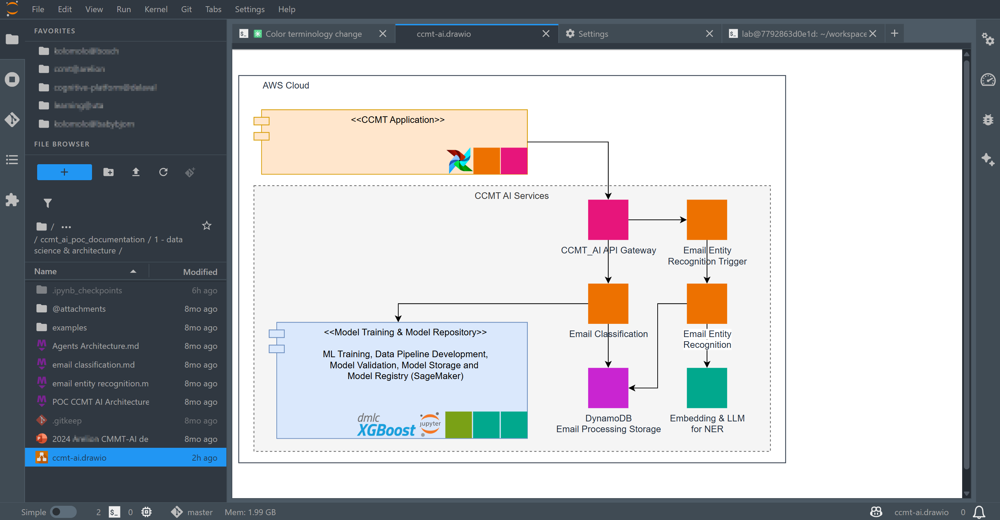

# jupyterlab_drawio_render_extension

[](https://github.com/stellarshenson/jupyterlab_drawio_render_extension/actions/workflows/build.yml)
[](https://www.npmjs.com/package/@stellarshenson/jupyterlab-drawio-render-extension)
[](https://pypi.org/project/jupyterlab-drawio-render-extension/)
[](https://pepy.tech/project/jupyterlab-drawio-render-extension)
[](https://jupyterlab.readthedocs.io/en/stable/)
[](https://kolomolo.com)
[](https://www.paypal.com/donate/?hosted_button_id=B4KPBJDLLXTSA)

> [!TIP]
> This extension is part of the [stellars_jupyterlab_extensions](https://github.com/stellarshenson/stellars_jupyterlab_extensions) metapackage. Install all Stellars extensions at once: `pip install stellars_jupyterlab_extensions`

View Draw.io diagrams directly in JupyterLab. Open any `.drawio` or `.dio` file and see it rendered with full fidelity - text, shapes, stencils, icons, and styles matching the official Draw.io application.

This extension uses the official [Draw.io viewer library](https://github.com/jgraph/drawio) from jgraph, served locally from the server extension for offline capability and CSP compliance.



## Features

- **Full Draw.io rendering** - Uses official Draw.io viewer library for pixel-perfect diagram display
- **Read-only viewer** - Safe viewing without accidental modifications
- **Interactive controls** - Scroll to zoom, drag to pan, layers panel, and lightbox view
- **PNG export** - Right-click to copy or download diagram as PNG with configurable DPI
- **Configurable background** - Choose from default (theme), black, white, or custom hex color
- **Full stencil support** - Veeam, Cisco, AWS, Azure, GCP, and all vendor shapes
- **Offline capable** - Viewer library served locally, no external network requests
- **JupyterLab 4 compatible** - Built for the latest JupyterLab release

## PNG Export

Right-click on any diagram to access export options:

- **Copy Diagram as PNG** - Copy to clipboard at configured DPI
- **Download Diagram as PNG** - Save as PNG file

Export automatically crops to diagram content with minimal padding.

## Agent skill and CLI

The package ships the `jupyterlab-drawio` CLI with four subcommands: `shapes` searches the official palette and stencil shapes, `stencils` lists the stencil sets, `validate` lints a `.drawio` file, and `layout` lays out a graph JSON with Graphviz.

The agent skill lives in the repository at `.agents/skills/jupyterlab-drawio-render-extension/` and is installed to `share/jupyter/agents/skills/jupyterlab-drawio-render-extension/`. No agent reads `share/jupyter/agents/skills`, so link the installed copy into the directory your agent reads.

After `pip install`, with the Python that runs the lab:

```bash
mkdir -p ~/.agents/skills && ln -sfn "$(python -c 'import sys; print(sys.prefix)')/share/jupyter/agents/skills/jupyterlab-drawio-render-extension" ~/.agents/skills/jupyterlab-drawio-render-extension
```

From a clone:

```bash
mkdir -p ~/.claude/skills && ln -sfn "$PWD/.agents/skills/jupyterlab-drawio-render-extension" ~/.claude/skills/jupyterlab-drawio-render-extension
```

## Settings

Configure the extension in **Settings > Draw.io Viewer**:

### Viewer Settings

| Setting                 | Description                                                      | Default   |
| ----------------------- | ---------------------------------------------------------------- | --------- |
| Background              | Viewer background: `default` (theme), `black`, `white`, `custom` | `default` |
| Custom Background Color | Hex color (e.g., `#f0f0f0`) when background is `custom`          | `#ffffff` |

### Export Settings

| Setting           | Description                                               | Default |
| ----------------- | --------------------------------------------------------- | ------- |
| Export DPI        | Resolution for PNG export (72-1200). Higher = larger file | `300`   |
| Export Background | PNG background: `transparent`, `white`, `black`, `custom` | `white` |

## Requirements

- JupyterLab >= 4.6.0
- Python >= 3.12

## Installation

```bash
pip install jupyterlab-drawio-render-extension
```

## Uninstall

```bash
pip uninstall jupyterlab-drawio-render-extension
```
